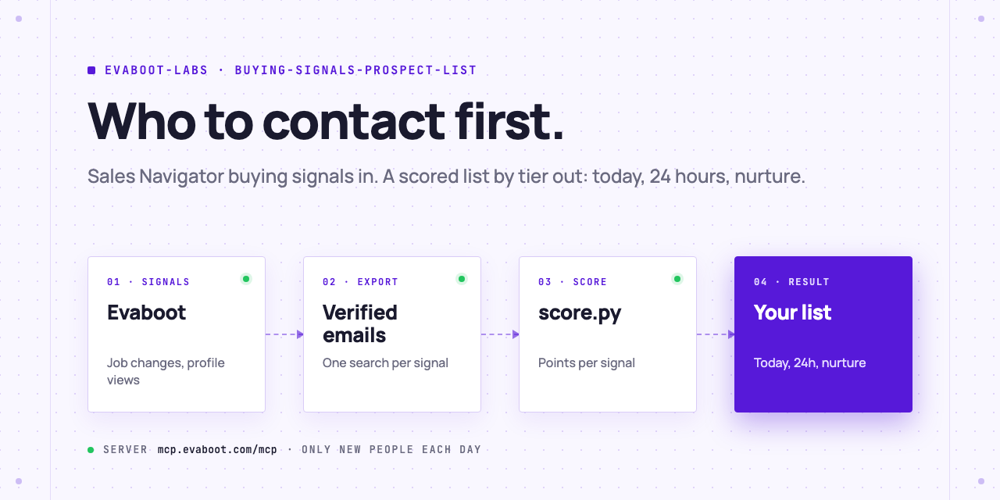

<picture>
  <source media="(prefers-color-scheme: dark)" srcset=".github/assets/banner-dark.png">
  
</picture>

# Buying-signal prospect list

Your AI agent runs one Sales Navigator search per buying signal (changed jobs, viewed your profile, follows your company, posted on LinkedIn), exports the people with verified emails, scores every signal they show, and sorts them into three tiers: contact today, within 24 hours, or nurture. You do the outreach.

[](AGENTS.md)
[](https://evaboot.com/mcp)
[](LICENSE)

## Set it up in one prompt

Paste this into Claude Code, Codex or Cursor:

```text
Clone https://github.com/evaboot-labs/buying-signals-prospect-list, read AGENTS.md and follow the skill. Build my buying-signal prospect list.
```

<details>
<summary>Or install the skill</summary>

Claude Code:

```text
/plugin marketplace add evaboot-labs/buying-signals-prospect-list
/plugin install buying-signals-prospect-list@evaboot-labs-buying-signals-prospect-list
```

Codex, Cursor and other agents:

```bash
npx skills add evaboot-labs/buying-signals-prospect-list
```

</details>

## How it works

**1. One search per signal, on the same buyers.** Your agent asks who you sell to, writes it into [`SIGNALS.md`](SIGNALS.md), and builds the buyer search with Evaboot. It adds one Sales Navigator filter per signal: changed jobs, viewed your profile, following your company, posted on LinkedIn.

**2. Every signal has points.** A person found by several searches gets the points of each. Their own data adds two more: under 3 months in the role, and company growth of 30% or more in a year. The points are a table in `SIGNALS.md`: tune them on your won and lost deals.

**3. Three tiers decide when to act.** 20 points or more: today. 10 to 19: within 24 hours. Under 10: nurture, and act on the next signal.

```text
$ python3 score.py list --signal changed_jobs=data/changed_jobs.json --signal follows_company=data/follows.json \
    --signal posted=data/posted.json --signal viewed_profile=data/viewed.json --csv lists/today.csv > lists/today.md
```

Three rows of a real run (44 people from 4 searches, 45 credits), with the people and companies left out:

| Tier | Score | Who | Signals |
|---|---|---|---|
| today | 24 | VP of Sales & GTM, North America | changed jobs, company +35% in a year, under 3 months in role |
| 24h | 19 | Director of Business Development | company +300% in a year, follows your company, under 3 months in role |
| nurture | 9 | Commercial Director | follows your company |

**4. Every day, only new people.** A daily recurring export repeats each search and returns only the people who are new to it.

**5. Or run it in n8n.** Evaboot sends each day's new people to a webhook, and every weekday at 8 the list lands in a Google Sheet, by tier. No AI key needed.

## What you need

- An [Evaboot account](https://dash.evaboot.com/accounts/signup/?last_click_origin=buying-signals-prospect-list-repo) and a Sales Navigator seat.
- An AI agent that can use an MCP server: Claude Code, Codex, Cursor, or the n8n version.
- Python 3.9+, with no packages to install.
- Cost: 1 Evaboot credit per exported lead, verified email included; each daily run only exports the new people.

## Go further

| Page | For |
|---|---|
| [docs/connect-your-agent.md](docs/connect-your-agent.md) | The setup by hand, for each agent |
| [docs/n8n.md](docs/n8n.md) | The same list in n8n, into a Google Sheet |
| [SIGNALS.md](SIGNALS.md) | Who you sell to, the signal searches, the points and the tiers |

---

Agents: start at [AGENTS.md](AGENTS.md) · Built by [Evaboot](https://evaboot.com) · More workflows at [github.com/evaboot-labs](https://github.com/evaboot-labs) · [MIT license](LICENSE)
